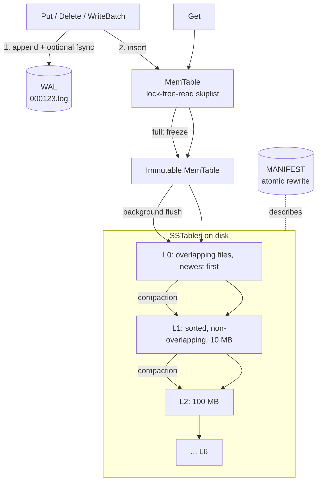

# lsmkv

A persistent, crash-safe key-value storage engine built on a log-structured merge tree, written from scratch in C++17 with no dependencies. It's the same architecture that sits under RocksDB, LevelDB, Cassandra, ScyllaDB, CockroachDB (Pebble) and the row stores inside many analytical databases.

```
$ make test
...
[  OK  ] RandomizedModelCheck
[  OK  ] ConcurrentReadersAndWriter
    283791 concurrent reads, 0 inconsistent
[  OK  ] DetectsSSTableCorruption
17 tests, 0 failures
```

## What it does

* **Durable writes.** Every write is appended to a checksummed write-ahead log before it becomes visible. `WriteOptions::sync` adds an `fsync` before the write is acknowledged.
* **Atomic batches.** A `WriteBatch` is one WAL record, so after a crash either all of its updates are recovered or none are.
* **MVCC snapshots.** Every update carries a 56-bit sequence number. `GetSnapshot()` gives a consistent point-in-time view that compaction will not garbage-collect out from under you.
* **Background flush and leveled compaction** on a dedicated thread, with write stalls as backpressure when L0 grows too large.
* **Bloom filters** (10 bits/key, measured false-positive rate of 0.84%) so a lookup for a missing key almost never touches disk.
* **LRU block cache** shared across tables, sized in bytes.
* **Crash recovery.** Replays the WAL, tolerates a torn tail, deletes orphan files left by an interrupted compaction, and refuses to open if another process holds the lock.
* **Corruption detection.** Every block, WAL record and the manifest are CRC32C-checksummed and verified on read.

## Architecture



| Layer | File | Notes |
|---|---|---|
| Encoding | `src/coding.*` | varints, fixed-width LE, CRC32C (Castagnoli) |
| Key format | `src/dbformat.h` | `user_key ‖ seq<<8 ‖ type`, sorted by user key ascending then seq **descending**, so the newest version comes first |
| MemTable | `src/skiplist.h`, `src/memtable.*` | single-writer skiplist; readers take no lock (acquire/release publication) |
| WAL | `src/wal.*` | `crc ‖ len ‖ payload`; replay stops cleanly at a torn record |
| SSTable | `src/block.*`, `src/table.*` | 4 KB prefix-compressed blocks with restart points every 16 keys, a bloom filter, an index block and a footer |
| Cache | `src/cache.h` | byte-bounded LRU of `shared_ptr` blocks; an evicted block stays valid for any iterator still using it |
| Versions | `src/version.h` | immutable file sets; readers pin one with a `shared_ptr` |
| Iterators | `src/iterators.*` | heap-based k-way merge and a concatenating per-level iterator |
| Engine | `src/db_impl.cc` | write path, read path, background thread, compaction, manifest, recovery |

## Design decisions worth talking about

**Concurrency model.** One mutex guards metadata (the active memtable, the current version and the sequence counter). Writers hold it while appending to the WAL and inserting into the skiplist. Readers hold it only long enough to copy three `shared_ptr`s and the sequence number. After that, all reading (skiplist traversal, block reads and binary search) happens without the lock. The skiplist is safe for concurrent reads because a node is fully built before a release-store links it in, and readers follow links with acquire-loads. Readers never see a half-applied batch because `last_sequence_` only advances, under the mutex, after the whole batch is inserted. TSan reports this clean.

**File lifetime through reference counting.** When compaction replaces files, it marks the old `FileMetaData` as obsolete but does not delete it. The file is unlinked in that struct's destructor, which runs when the last `Version` or iterator referencing it is released. A long-running scan therefore never has its files deleted from under it, and no epoch or GC thread is needed.

**Compaction correctness rules** (`RunCompaction`):
1. If a newer version of the key is already visible to the oldest live snapshot, drop the older version.
2. Drop a tombstone only if it is older than every snapshot **and** no deeper level could still hold the key it shadows (`IsBaseLevelForKey`). Dropping it any earlier would resurrect deleted data.
3. Cut output files only between user keys, so a level of 1 or deeper never has one key spanning two files. That keeps point lookups to one file per level, found by binary search.
4. **Trivial move:** if a file has nothing to merge with at the next level, the engine re-links its metadata one level down without rewriting the file.

**Manifest as an atomic snapshot.** Unlike LevelDB's append-only edit log, the manifest is the full file list, rewritten with a temp-file + `fsync` + `rename` + directory-`fsync` sequence. That costs O(files) bytes per change, which is negligible at this scale, and removes a whole class of log-replay bugs.

**Recovery protocol.** 
1. Load the manifest.
2. Delete `.sst` files the manifest doesn't reference (left by a compaction that crashed before installing).
3. Replay every WAL at or after the manifest's `log_number`.
4. Flush the recovered memtable to L0.
5. Write a new manifest pointing at a fresh WAL.
6. Delete the replayed WALs.

## Benchmarks

`./build/lsmkv_bench 500000 100`: 500k random 16-byte keys, 100-byte values, default options (4 MB memtable, 8 MB cache). Measured on a 4-vCPU ARM64 Linux VM on an Apple-silicon MacBook Air.

| Benchmark | Throughput | p50 | p99 |
|---|---|---|---|
| fillrandom | 284k ops/s (32.9 MB/s) | | |
| overwrite | 200k ops/s | | |
| fillsync (fsync per write) | 3.7k ops/s | 230 µs | 635 µs |
| readrandom (hit, 65 MB DB, 8 MB cache) | 69k ops/s | 15 µs | 31 µs |
| readmissing | **677k ops/s** | **1.1 µs** | 8.5 µs |
| readseq (full scan) | 1.93M ops/s (224 MB/s) | | |

* For missing keys, the **bloom filters skipped 99.2%** of table probes (815,092 of 821,814). That is why `readmissing` runs ~10x faster than `readrandom`.
* Write amplification is **5.45x**, counting WAL + flush + compaction bytes against user bytes. Leveled compaction trades write amplification for read and space amplification, and this number makes that trade concrete.

## Testing

`make test` runs 17 tests, including:

* **`RandomizedModelCheck`:** 48,000 random puts, deletes and multi-key batches, interleaved with closing and reopening the DB, forced flushes and full compactions. After every phase it checks every key, through both `Get` and a full scan, against a `std::map` reference model.
* **`ConcurrentReadersAndWriter`:** 4 reader threads check an invariant while the writer drives memtable rotations, flushes and compactions underneath them.
* **`SnapshotIsolationSurvivesCompaction`:** a snapshot still sees old values, through `Get` and iterators, after newer versions and tombstones are fully compacted.
* Crash and corruption cases: WAL torn-tail recovery, an SSTable byte flip detected as `Corruption`, and lock contention.

`make asan` and `make tsan` rebuild the library and tests with AddressSanitizer + UBSan and ThreadSanitizer. Both are clean.

## Build and use

```bash
make            # library, tests, bench, CLI (needs only g++/clang++ with C++17)
make test
make bench
./build/lsmkv_cli /tmp/demo
> put user:1 zaid
> scan user:
> stats
```

```cpp
#include "lsmkv/db.h"
std::unique_ptr<lsmkv::DB> db;
lsmkv::DB::Open(lsmkv::Options(), "/tmp/db", &db);
db->Put({}, "k", "v");
std::string v;
db->Get({}, "k", &v);
```

## What I'd build next

* **Group commit:** batch concurrent writers into one WAL append and one `fsync` (the leader/follower queue from LevelDB). This is the single biggest win for `fillsync`.
* Run compaction on a separate thread from flushes, so a long L1→L2 merge can't stall writers behind an unflushed memtable.
* Block compression (LZ4) and per-block bloom filters (partitioned filters).
* A fault-injecting `Env` that simulates power loss at every `write`/`fsync` boundary, for exhaustive crash testing.
* Reverse iteration and range deletes.
